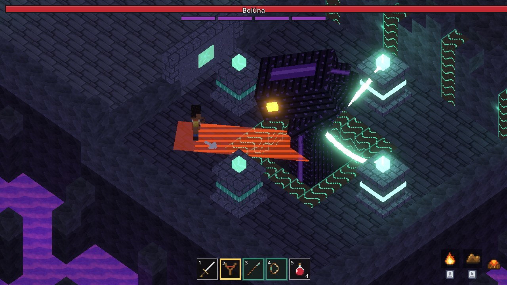
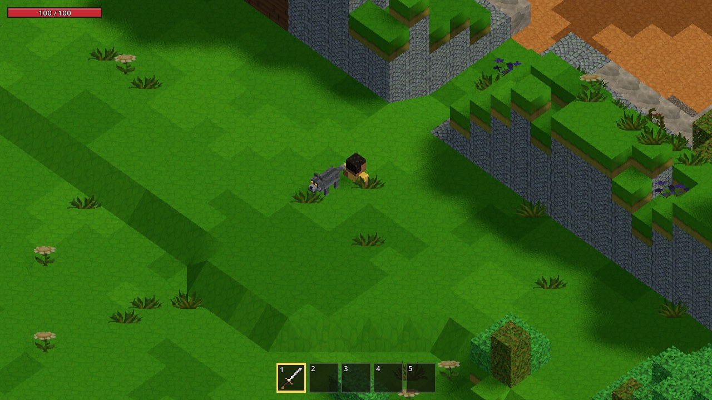
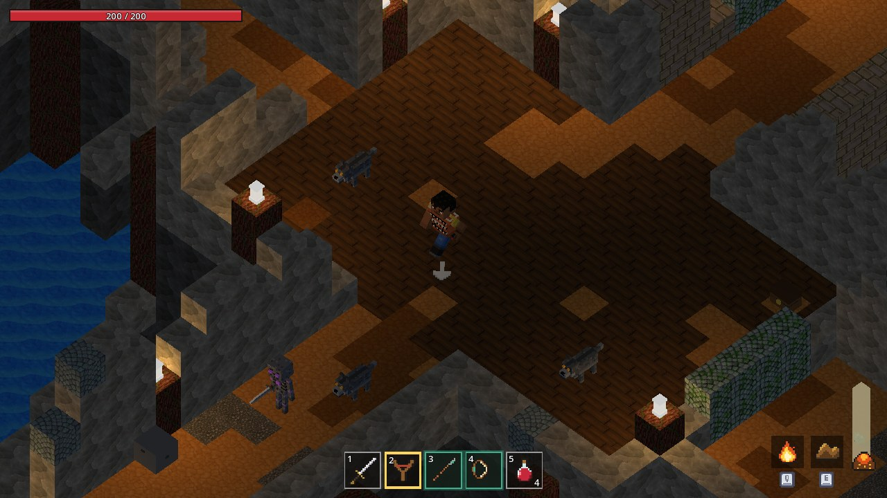
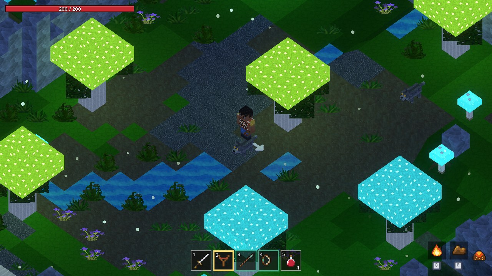
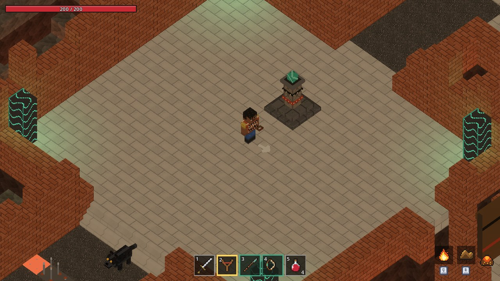
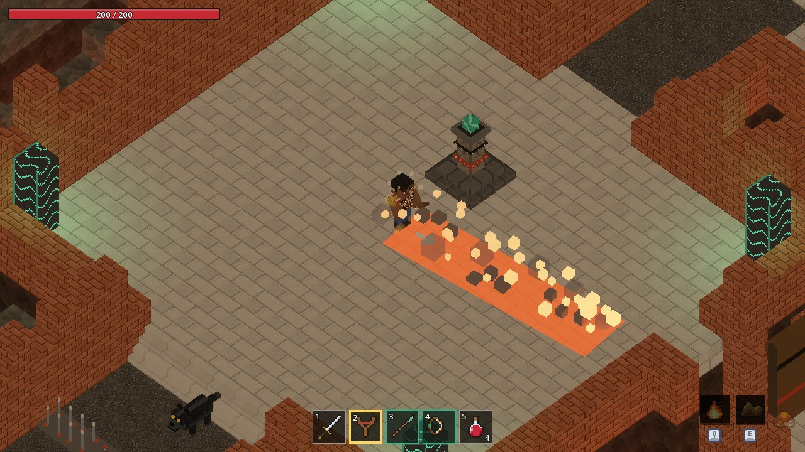
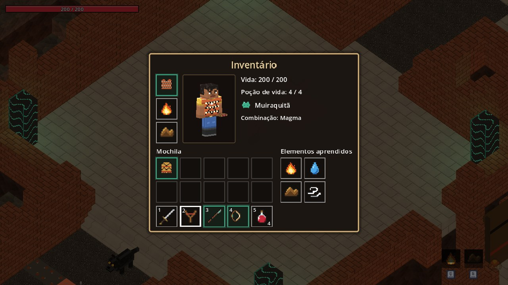
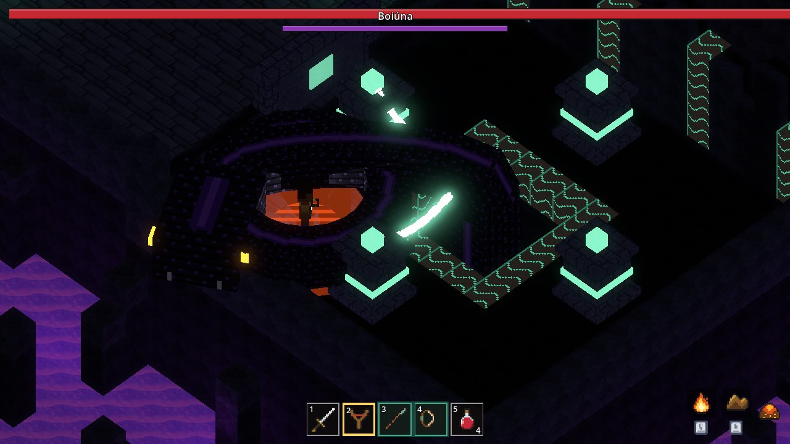
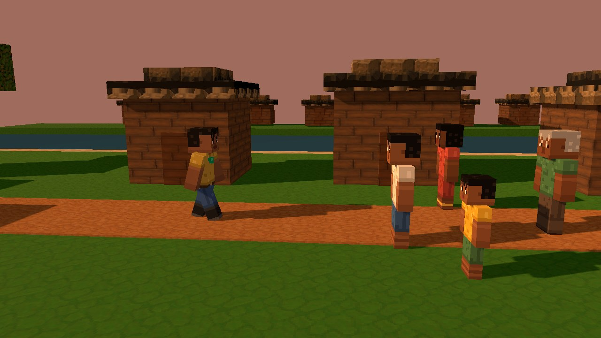

# Nate: Undue Redemption

Ação e aventura isométrica em blocos, num mundo subterrâneo do folclore amazônico. Feito na **Godot 4.7.2**, com GDScript tipado.



## Sobre

Nate vive em Nhamundá, na beira do rio, rejeitado pela cidade. Um tremor abre uma fenda na velha mina da família, e ele segue um lobo até Agartha, um mundo gigantesco sob a floresta, isolado por milhares de anos. Lá, um muiraquitã acorda no peito dele, e a história do povo antigo aparece aos poucos, em murais e memórias: a Grande Prisão que o último herói não conseguiu fechar e a Boiúna, a Cobra Grande, que está acordando.

São cerca de 30 minutos pelo caminho principal e 45 com todos os segredos, do prólogo à luta final e ao pós-jogo. É um projeto piloto: o primeiro jogo, feito para aprender os sistemas do gênero, na linha de Minecraft Dungeons.

## Imagens

<table>
  <tr>
    <td><br><sub>O prólogo: a clareira na borda da mina, e o lobo</sub></td>
    <td><br><sub>A Mina, com os lampiões e a galeria inundada</sub></td>
  </tr>
  <tr>
    <td><br><sub>O Bosque de Fungos: cogumelos gigantes e riachos que brilham</sub></td>
    <td><br><sub>As Ruínas do povo marajoara, com o santuário</sub></td>
  </tr>
  <tr>
    <td><br><sub>Magma: Fogo e Terra combinados</sub></td>
    <td><br><sub>O inventário, no jeito do Minecraft</sub></td>
  </tr>
  <tr>
    <td><br><sub>A fase 2 da Boiúna: o cerco na escuridão</sub></td>
    <td><br><sub>A cena final, de volta a Nhamundá</sub></td>
  </tr>
</table>

## O que tem no jogo

- **Um mapa contínuo:** o prólogo na borda da mina, a Mina, o Bosque de Fungos, as Ruínas e a Grande Prisão, com atalhos, abismos e pontes.
- **Combate claro e com peso:** todo golpe inimigo é avisado antes, com a marca no chão igual à área que ele acerta. Tem combo, tiro, dash com golpe e a poção de vida.
- **Quatro elementos** aprendidos em pergaminhos (Fogo, Água, Terra e Ar): quatro magias e seis combinações, com o par equipado definindo o estilo de jogo.
- **Inimigos:** lobos, esqueletos, necromantes e golens, cada um com a sua variante, além de arenas por ondas e três arenas opcionais escondidas.
- **A Boiúna,** o chefe final, em duas fases: na primeira, Nate a prende com os pilares da prisão; na segunda, ela ataca no escuro, e só a luz do muiraquitã a revela.
- **Exploração:** 4 santuários com memórias, 7 murais, 13 melhorias, armaduras e armas escondidas, cantos escuros e paredes rachadas para voltar depois.
- **Fim completo:** a cena final, os créditos, o resumo da partida e o pós-jogo, para achar o que faltou.
- **Jogo salvo** a cada conquista, com conversão das versões antigas.

## Controles

| Ação | Teclado e mouse | Controle (Xbox / PlayStation) |
|------|-----------------|-------------------------------|
| Andar | W A S D | analógico esquerdo |
| Mirar | mouse | analógico direito |
| Atacar (combo) | botão esquerdo | X / □ |
| Atirar ou beber a poção (segurar) | botão direito | RT / R2 |
| Escolher o item da mão | 1 a 5 e a roda do mouse | direcional ◀ e ▶ |
| Dash (com atacar, o golpe do dash) | Espaço | A / ✕ |
| Magia 1 e 2 (as duas juntas: combinação) | Q e E | LB e RB / L1 e R1 |
| Interagir | F | B / ○ |
| Murais | G | direcional ▲ |
| Inventário | Tab | View / Touchpad |
| Pausa | Esc | Menu / Options |

## Como jogar

O jogo roda pelo editor, sem versão exportada:

1. Instale a [Godot 4.7.2](https://godotengine.org/download/archive/4.7.2-stable/) (a versão padrão, sem .NET).
2. Abra o arquivo `game/project.godot` na Godot.
3. Aperte F5. O jogo começa no menu principal.

## Como foi feito

- **Documentação primeiro:** o jogo inteiro foi desenhado em [`docs/`](docs/) antes de virar código, com a história, as regras, os itens, os mobs, o chefe, o mapa, a interface, a arte, o balanceamento e o técnico. Depois, foi construído em etapas, cada uma terminando com algo jogável ([`docs/13-plano-de-producao.md`](docs/13-plano-de-producao.md)).
- **Tudo por código:** os personagens e os objetos são caixas definidas em dados, com a pele pintada por scripts no molde das skins do Minecraft; as animações são poses em dados; as áreas saem de rascunhos em texto, montadas por geradores (`game/tools/`).
- **Números nos dados:** nenhum número fica no código. Todos estão em `game/data/` e em [`docs/11-balanceamento.md`](docs/11-balanceamento.md).
- **Feito com o [Claude Code](https://claude.com/claude-code),** da Anthropic.

```
docs/   os documentos do jogo
game/   o projeto da Godot
  ├── boss/      a Boiúna e a luta
  ├── combat/    golpes, vida, efeitos e magias
  ├── data/      números, modelos, animações e sons
  ├── mobs/      lobo, esqueleto, necromante e golem
  ├── player/    Nate
  ├── tools/     geradores dos modelos, das peles e das áreas
  ├── ui/        HUD, inventário, menus e telas
  ├── world/     áreas, objetos, armadilhas e cenas
  └── tests/     testes automáticos (gdUnit4)
```

### Testes

Da raiz do repositório:

```bash
godot --headless --path game -s res://addons/gdUnit4/bin/GdUnitCmdTool.gd -a res://tests --ignoreHeadlessMode
```

## Créditos

**Um jogo de Natan Foleto.**

A arte e o som são provisórios: pacotes prontos com licença livre, mais o que foi feito para o jogo (os modelos, as peles, os murais, os ícones e os efeitos).

| Asset | Autor | Licença |
|-------|-------|---------|
| [Big pack of hand painted tiling textures](https://opengameart.org/node/91360) | drummyfish | CC0 |
| [RPG Audio](https://kenney.nl/assets/rpg-audio), [Impact Sounds](https://kenney.nl/assets/impact-sounds), [Interface Sounds](https://kenney.nl/assets/interface-sounds) e [Input Prompts Pixel 16×](https://opengameart.org/content/input-prompts-pixel-16%C3%97) | Kenney | CC0 |
| [80 CC0 creature SFX](https://opengameart.org/content/80-cc0-creature-sfx) e [#2](https://opengameart.org/content/80-cc0-creture-sfx-2) | rubberduck | CC0 |
| [8 Magic Attacks](https://opengameart.org/content/8-magic-attacks) | leohpaz | CC BY 4.0 |
| [Free Music Pack](https://opengameart.org/content/free-music-pack) | Alexander Ehlers | CC0 |
| [Krakatoa](https://opengameart.org/content/krakatoa) | Kistol | CC0 |
| [Loopable Dungeon Ambience](https://opengameart.org/content/loopable-dungeon-ambience) | JaggedStone | CC0 |
| [Godot Engine](https://godotengine.org) | os colaboradores do Godot Engine | MIT |

O registro completo dos assets está em [`docs/10-arte-audio.md`](docs/10-arte-audio.md).

## Licença

O código e os documentos não têm licença aberta por enquanto: são do autor. Os assets de terceiros seguem as próprias licenças, listadas acima.
